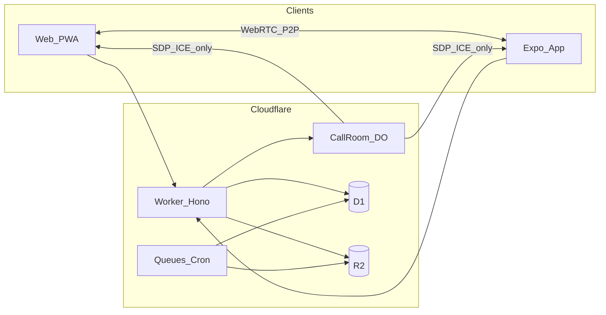

# LogosHome (圣言家) Architecture

## Product summary

LogosHome is a productized Bible reading + discipleship + church community platform:

1. **Bible Reader** — translations (zh/en/ja), highlights, bookmarks, notes, typography, study materials, deep links to Endao / WeRead when SSO is available.
2. **Plans & Devotion** — create/subscribe plans, CSV import/edit, devotion practice steps + open materials.
3. **Home (Church)** — multi-church entries, groups, forum/notices, external A/V embeds; E2EE DM/groups, disappearing messages, archives; WebRTC P2P calls + screen share.
4. **Me** — signature, UID, nickname, legal name, church verification, privacy-scoped discovery.

Deploy target: **Cloudflare Workers + D1 + R2 (+ Durable Objects, Queues, Cron)**.

Clients: **Web PWA (React)** and **Expo (iOS/Android)** sharing packages.

## Monorepo layout

```
apps/
  api/       Hono Worker — REST, auth, signaling DO stubs, wipe/cron
  web/       React + Vite PWA
  mobile/    Expo Router app
packages/
  shared/    Zod schemas, IDs, API types, i18n message catalogs
  bible/     Translation registry, verse refs, content loaders
  crypto/    X3DH/Double Ratchet helpers, note envelope crypto
  ui/        Design tokens + shared React primitives (web)
docs/        Architecture, security, product, roadmap
```

## Tech choices

| Layer | Choice | Why |
| --- | --- | --- |
| API | Hono on Workers | Tiny, typed, CF-native |
| ORM | Drizzle + D1 | SQL migrations, type-safe |
| Media | R2 | Large files / encrypted blobs; not D1 |
| Realtime | Durable Objects WS | Signaling & presence |
| Web | React 19 + Vite + TanStack Query/Router | Product UX velocity |
| Mobile | Expo SDK | Shared TS, WebRTC modules, store builds |
| i18n | i18next (zh-CN, en, ja) | Product requirement |
| Themes | CSS variables + theme packs | Light/sepia/night/high-contrast |
| Auth | Custom session + device keys | Fits E2EE device model |

## High-level data flow



## Module boundaries

- **Reader** reads P0 bible content from R2/KV or bundled PD packs; annotations (P3) encrypted client-side, sync ciphertext via API.
- **Plans** are shareable metadata (P0/P1) with optional private progress (P3).
- **Home forum** posts may be church-scoped plaintext at rest with field encryption in `standard` mode; pastoral DMs always P4 E2EE.
- **Chat** never sends plaintext bodies to the API.
- **Admin wipe** is control-plane only; see [SECURITY.md](./SECURITY.md).

## Bible translations strategy

**Do not embed full Bible corpora in TypeScript.** Verses are data: server R2 chapter JSON + client local DB after download.

| Mode | Examples | Where text lives |
| --- | --- | --- |
| **Boot defaults** (few) | 和合本简体 `cuvs`, WEB, 新共同訳 `shinKyoudou` | Seeded into client IndexedDB (`lh-bible`) on first launch; chapters also served from R2 when present |
| **Downloadable** | CUVT, RCUV, CCB, 吕振中, 口語訳, 新改訳, KJV, ASV… | User downloads pack → install into local DB; source of truth is R2 (`bible/{tid}/Book.N.json`) |
| **External** | ESV, NIV, 恩道, 微读, 思高… | Deep link / partner SSO — not stored in-app (license) |

`packages/bible` exposes `TranslationProvider`: `local | r2 | external`, plus `LocalCorpusDb` + `/v1/bible/corpus-catalog` + `/v1/bible/corpus-download/:tid`. Reader prefers **local DB**, then API/R2. Corpora are imported as **JSON fixtures** (`fixtures/corpus/{tid}/Book.N.json`) via `corpus-import` / `seed-r2-from-json-fixtures.mjs` — not densified TypeScript. TS chapter scaffolds are demo/test only.

## Environments

- `dev` — local `wrangler dev` + Vite
- `staging` / `production` — separate D1/R2/KEK

## Non-goals for foundation sprint

- Full libsignal parity audit (skeleton + interfaces first)
- Real partner SSO (adapter stubs + feature flags)
- App Store submission binaries in CI
